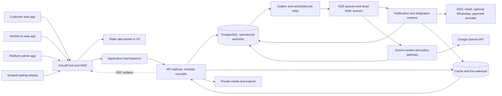

# Complete beauty salon and parlour platform architecture

## 1. Product and architectural decisions

Build a multi-tenant salon operations platform. A **tenant** is one independently owned business; a tenant owns one or more **branches**. A customer can use several businesses, but each business has its own customer profile, notes, preferences, consent and service history. Tenant isolation is mandatory from the first release.

The platform supports appointment-led salons, walk-in parlours and mixed operations. A booking may contain multiple services and multiple professionals, but initially serves **one recipient at one branch**. A family organiser may create separate linked bookings for different recipients. A package is a priced set of service items, not a single arbitrary-duration slot.

Pakistan-first defaults are PKR, `Asia/Karachi`, English and Urdu interfaces, Roman Urdu input support for the staff assistant, normalised `+92` phone numbers, cash checkout, printable receipts, mobile-first customer access, and receptionist-assisted operation for people without smartphones. Defaults are configurable and versioned; legal tax rates and cancellation charges are not hard-coded.

| Decision | Selected approach | Why |
|---|---|---|
| Backend | TypeScript modular monolith on Node.js/Express; separate API, worker and AI-worker processes built from shared packages | Keeps reservations, visits and money transactional while allowing independent capacity limits. |
| Frontends | React/TypeScript with Vite; customer, workforce and platform-admin builds | Extends a familiar MediFlow pattern; separate bundles reduce accidental exposure and allow different release policies. |
| Database | Managed PostgreSQL, with a supported major version pinned in infrastructure | Relational consistency, interval exclusion, tenant policies, transactional jobs and reporting. |
| Reservation authority | PostgreSQL constraints and transaction locks | A cached availability result is not a booking guarantee. |
| Live updates | HTTPS commands plus SSE invalidations/snapshots | Operations mostly need server-to-browser updates, not a bidirectional protocol. |
| Async work | Transactional outbox → SQS workers; PostgreSQL scheduled jobs | Durable reminders, integrations and reconciliation across restarts. |
| Cache and fan-out | Managed Redis-compatible cache | Shared rate limits, short-lived public cache and transient live-event wakeups; never reservation authority. |
| Media | Private S3 objects, signed access and upload quarantine | Separate file capacity from the relational store. |
| Hosting | AWS ECS/Fargate, ALB, RDS, S3/CloudFront, SQS, Secrets Manager and KMS | Containerised deployment without a bespoke server maintenance model. AWS is a design choice appropriate to this workspace, not an inferred contest rule. |
| AI | Gemini API through a dedicated server-side adapter | Mandatory integration has useful staff workflows and bounded access. |

At initial release, concurrency between services on the **same recipient** is disabled. Sequential steps and unattended processing are supported. Simultaneous hair/nail treatments, multi-person bridal events and arbitrary optimisation graphs can be added later after explicit compatibility, staffing and consent rules exist. Ordinary bridal packages remain supported as ordered, resource-reserved appointments; complex quotes use a staff-reviewed proposal.

## 2. System context and communication



Clients never access PostgreSQL, Redis, SQS, payment secrets or Gemini credentials. Only server-generated signed URLs permit constrained file upload/download. Browser commands are ordinary authenticated REST calls. Live events tell clients what changed; clients obtain an authorised canonical snapshot when necessary.

All business modules live in one repository and share one PostgreSQL database. Controllers validate transport schemas; services own policy and transactions; repositories execute parameterised SQL. Modules cannot mutate each other's tables directly except through a shared, explicitly orchestrated transaction. External calls occur outside database transactions.

| Module | Owns | Collaborates with |
|---|---|---|
| Identity and access | Sessions, OTP challenges, workforce credentials, roles, branch scopes | All HTTP, jobs and SSE entry points |
| Tenant and branch | Business settings, locations, hours, policy versions | Catalogue, schedules, reporting |
| Customer | Tenant profiles, recipient relationships, preferences, consent, profile merge | Booking, service delivery, messaging |
| Catalogue | Services, variants, phases, packages, prices, eligibility rules | Availability, pricing, AI retrieval |
| Workforce/resources | Skills, duration overrides, shifts, leave, chairs, rooms, equipment | Scheduling and dispatch |
| Scheduling | Availability, quotes, holds, reservations, rescheduling and impacts | Booking, workforce, payments |
| Visits and dispatch | Check-in, arrival proofs, ready steps, calls, occupancy, service outcomes | Scheduling, customer, checkout |
| Commerce | Invoices, payment ledger, deposits, refunds, credits, stock, commissions | Bookings, providers, reports |
| Communications | Templates, preferences, reminder jobs, delivery attempts | Domain events and provider adapters |
| AI assistance | Request redaction, retrieval, Gemini calls, output validation, cost accounting | Read-only catalogue, availability and metrics tools |
| Operations and audit | Audit events, support access, exports, reconciliation, monitoring | Every mutation |

## 3. Roles, permissions and interfaces

Permissions are capabilities plus tenant/branch scope, not just a role string. Membership checks occur on every request. Customer access additionally requires a verified account-to-profile/recipient relationship. Owners are not automatically authorised to view every sensitive service note.

| Role | Interface and allowed work | Restrictions |
|---|---|---|
| Customer / authorised organiser | Discover branch and services; choose professional or any qualified professional; view exact quote, duration and policies; reserve/pay; pass; live arrival/service status; cancel/reschedule; history and receipts | Own or explicitly delegated recipients only; no staff calendars containing other customers. |
| Beauty professional | Personal day plan, assigned service steps, relevant consent/notes, ready/called/in-service states, handover, actual duration, products used, own commission statement | Cannot change tenant prices, refunds, another professional's work, or broad customer exports. |
| Receptionist | Branch calendar, phone bookings, guest profiles, walk-ins, QR/manual arrival, dispatch, reassignment within skills, checkout and receipt printing | Refund/discount limits, no workforce security or unrestricted exports; sensitive notes only when required. |
| Branch manager | Reception functions, shifts/leave, exceptional cancellation and refund approvals, branch reports, stock and cash close | Assigned branches; no owner transfer or platform configuration. |
| Owner | Branch setup, catalogue, price/policy publication, memberships, financial and capacity reports, commission configuration | Sensitive-note access separate; step-up authentication for refunds, exports and owner changes. |
| Platform administrator/support | Tenant onboarding, subscriptions, service health, abuse and incident handling | No routine tenant customer visibility; time-limited, reasoned support grants and immutable audit. |
| Display device | Current anonymous token calls and approximate waits for one branch | No names, phone numbers, images, notes, private services or mutation capability. |

A person can have multiple roles. A receptionist who is also a professional receives the union of explicit capabilities within the appropriate branch, with sensitive actions still subject to separate limits.

### Customer experience

Flow: branch → service variant/package → optional professional preference → feasible full-visit slots → price/policy summary → short hold → customer verification/payment if required → confirmed pass. Display both start and expected finish. Show whether the time is a **reserved appointment** or an **estimated walk-in window**. Show a named professional only after assignment; “any professional” still creates a concrete internal reservation.

For poor connectivity, cache the app shell and public catalogue only. Keep a minimal pass available offline if the customer explicitly saves it. Do not persist sensitive customer histories or authorize offline bookings. An uncertain command shows “Checking whether this succeeded” and recovers using its request key.

### Reception and professional experience

Reception gets a staff/resource calendar and separate boards for expected arrivals, arrived customers, ready service steps, in-service work, delayed work and checkout. A whole visit has one customer-facing reference; each step shows its professional, room/chair, planned and actual times, and predecessor status.

Professionals get large start/complete buttons, a clear next customer, required preparation or consent checks, and a delay action. A start action fails with an actionable reason if another customer occupies the staff member or resource. Handover marks the next step ready only after prerequisites pass.

### Owner and platform experience

Owners see bookings, capacity, realised revenue, deposits held, pending refunds, no-shows, actual waits, service duration variance, repeat visits, inventory alerts and cash close discrepancies. Metrics have definitions and data freshness. Platform administration is a separate origin/build with stronger access controls and minimal personal data.

### Frontend engineering requirements

Use React Router, a server-state query/cache library, schema-validated forms and generated API types. Keep auth/session state separate from domain data. SSE invalidates narrowly scoped caches and uses resource versions to reject stale updates. Avoid optimistic “confirmed” booking/payment screens before acknowledgment. Preserve unsent non-sensitive form edits through session recovery, bound to the originating account and tenant; clear on account change.

Target keyboard-complete workflows, labelled controls, visible focus, screen-reader status announcements, text alongside colour, reduced motion, and touch targets of at least 44 px. Urdu uses RTL layout with deliberate LTR rendering for codes and phone numbers. Tables need mobile alternatives; dense calendars need list views. Camera access requires explicit browser permission with manual-code fallback. These are implementation requirements, not claims of audited accessibility compliance.

## 4. Catalogue and service modelling

A service variant has a name, description, price basis, tax category, active dates, eligibility flags, required skill, allowed professionals, resource requirements, setup time, service phases, cleanup, optional add-ons, preparation instructions and cancellation/deposit policy. Examples: haircut by hair length; colour application with processing; manicure with removal add-on; bridal makeup with a named specialist and private room.

**Duration is operational data.** Catalogue defaults can have approved professional-specific overrides; the selected durations are snapshotted at confirmation. Record active work, unattended processing and cleanup separately. Do not let the model infer a short duration from an image or request.

Example: colour + cut starting 14:00:

| Phase | Time | Professional | Physical capacity | Recipient |
|---|---|---|---|---|
| Application | 14:00–14:30 | Stylist A reserved | Chair 1 reserved | Occupied |
| Processing | 14:30–15:00 | Released only if configured safe | Chair 1 stays reserved | Occupied |
| Rinse | 15:00–15:15 | Stylist A or approved assistant, assigned in advance | Basin 1 | Occupied |
| Cut | 15:15–15:45 | Stylist A | Chair 1 | Occupied |
| Cleanup | 15:45–15:55 | Staff time if required by configuration | Chair 1 | Recipient released |

The planner must reserve the return to Stylist A at 15:15; releasing the stylist during processing does not permit a conflicting booking that runs beyond that return. Whether Chair 1 remains occupied during the rinse is an explicit phase resource rule. Resource intervals that overlap within the same visit are merged before insertion, so the reservation constraint does not reject the visit against itself.

Add-ons contribute explicit phases, dependencies and prices. Package item discounts are allocated deterministically for partial cancellation/refund calculations. Price changes do not silently change existing confirmed bookings. Variable-price services show a range and require a staff quote before a binding booking/deposit; the quoted scope, ceiling and duration become explicit customer-approved snapshots.

## 5. Availability and booking

### Slot generation

1. Resolve active catalogue and policy versions, recipient constraints and selected variants.
2. Expand services into an ordered phase plan, including setup, processing, transitions and cleanup.
3. Find qualified professionals. Apply explicit preference as a hard constraint unless the customer permits alternatives.
4. Intersect branch hours, staff shifts, breaks/leave, resource hours and maintenance windows. For shared staff, include other-branch bookings and configured travel buffers.
5. Subtract unexpired holds, confirmed reservations and actual occupancy/blockers. Evaluate all phase requirements; start times default to a five-minute grid.
6. Bound search to 90 days, six service items and a configured number of candidate assignments. Use deterministic bounded backtracking for ordered phases, not a language model. If the complexity limit is exceeded, request staff-assisted scheduling rather than claim “no availability.”
7. Rank feasible plans by earliest completion, minimum waiting between steps, explicit professional preference, then load balancing and stable asset ID. Return at most 20 options per page with quote ID, validity and plan fingerprint.

Actual allocation always revalidates. Cached/public results expire after at most 30 seconds and are advisory. Slot generation reads the primary database when current occupancy or pending holds matter. A catalogue or schedule change invalidates affected cached plans.

### Holds and confirmation

Standard hold: five minutes, one active checkout hold per customer/recipient/branch, with abuse limits per account and network. An online payment attempt can extend it once to a total of ten minutes. Server clock determines expiry. Staff-assisted quote holds can use a separately bounded manager policy.

Create the hold, all staff/resource/recipient reservations, the price/policy snapshot and the idempotent command result in one transaction. Lock affected assets and recheck availability. PostgreSQL exclusion constraints are the final overlap guard. A hold expiration job and the next relevant booking transaction both deactivate expired reservations; time-dependent predicates are not used inside database constraints.

With pay-at-salon, confirmation consumes the valid hold immediately. With deposits, the booking remains pending until a verified payment result is processed. The client redirect never proves payment. Confirmation atomically changes the hold reservation ownership/status, booking state and notification intent.

If payment succeeds after the hold is lost, attempt to reacquire the same plan transactionally. If unavailable, mark the payment as unapplied and initiate a refund or staff reconciliation; do not silently book a different time. Persist the result so retries cannot create another visit or payment.

### Appointment changes

Rescheduling holds a proposed new plan while keeping the old confirmed reservation. Customer approvals include price differences and policy fees. On commit, old reservations are released and new reservations become confirmed in one transaction. A replacement hold may reuse intervals of the same booking under a replacement-group rule: store only the additional time ranges as new hold reservations; final confirmation rewrites the full canonical plan under the same asset locks. Expiring the replacement releases only those extra ranges.

Cancellation releases only unstarted reservations, revokes the pass and creates any refund/credit job. A started service requires early termination or partial completion, not ordinary cancellation. No-shows require absence of arrival evidence and a policy-specific grace period; never auto-mark someone already checked in as absent.

Schedule edits preview impacted appointments. Leave, branch closure, service retirement or resource maintenance cannot silently delete bookings. Block new availability immediately, flag existing appointments for manager resolution, offer qualified reassignment/rescheduling/refund, and notify affected customers. Already-confirmed snapshots remain auditable.

## 6. Arrival, walk-ins and live dispatch

### Arrival verification

Use a versioned pass with a random opaque token whose hash is stored server-side. The pass contains no phone number or service notes. It identifies the current booking version and branch; expiry, cancellation and rescheduling invalidate old tokens. A scan requires an authenticated staff device and branch access. The server resolves the booking, records an arrival proof and idempotently creates/returns a visit.

Manual arrival requires booking lookup plus a staff-recorded verification method; a public short number alone cannot authorize profile access. A screenshot may prove possession of a pass, not identity for account recovery or payment. Duplicate scans return the same visit. Early arrivals wait until eligible; late arrivals are revalidated for feasibility before admission. Default arrival window is 30 minutes early to 15 minutes late, configurable by service and branch.

### Walk-ins and booking waitlists are different

For a walk-in, reception selects services and a professional preference, creates or selects a minimal tenant customer/guest profile, and runs the same planner. It offers either a feasible start reservation or a non-guaranteed waiting estimate. Accepting a feasible plan creates a booking with source `walk_in`, arrival proof and visit atomically. A person waiting without reserved capacity remains a waiting entry and cannot displace confirmed appointments.

A booking waitlist is for a future cancellation opening: desired date range, service constraints, recipient and notification consent. An opening generates one time-limited offer with a real hold. Acceptance uses normal confirmation; expiry passes the offer to the next eligible request. Notification delivery alone never creates an appointment.

Guests need not share a phone or create an account. If no contact method exists, print a visit reference and manage the visit in person. Linking a guest profile to an account later requires verified ownership/staff review, not a name match. Merges preserve all original record links and audit history.

### Dispatch policy

Do not advertise one universal queue position. The branch has ready **service steps**, and each professional/resource has different availability. The customer sees their next step, a bounded estimated start range, and any delay.

Eligibility requires: verified arrival; valid service consent/preparation gates; predecessor completed or configured processing time elapsed; qualified on-duty staff; available physical resources; no actual conflicting occupancy; and a feasible effect on upcoming reservations.

Priority order among feasible steps:

1. Time-critical continuation of an already-started treatment whose processing deadline is due.
2. Due, arrived appointments, ordered by planned start then arrival time.
3. Late appointments accepted into a revised feasible plan.
4. Walk-ins and early appointments that fit the idle gap without delaying reserved work, ordered by waiting age then creation ID.

Unattended treatments that require monitoring reserve appropriate staff time; never assume processing is safe to leave unattended. A waiting-age threshold (default 30 minutes) raises a reception alert but does not override physical capacity or promised appointments. Managers may reprioritise with a reason and affected-customer notification. They cannot override skill, consent or exclusive occupancy checks.

`call-next` locks eligible work and required assets, verifies versions, then issues a short call lease (default two minutes). Only one dispatcher wins. `start` creates exclusive occupancy for every required asset. A missed call moves the step to `temporarily_absent`; one repeat call is allowed before reception chooses requeue or abandonment. Calling and starting are separate states.

### Delays and forecasts

Plan reservations and actual occupancy are separate records. An overrun can extend beyond a planned interval; actual occupancy always blocks another start. The system recalculates feasible predicted starts, marks affected reservations at risk and asks reception to resolve conflicts. It must not delete a downstream confirmed reservation to make the display look feasible.

Forecasts use remaining active time, processing deadlines, reservation order, skills and resource constraints. Start with catalogue durations; introduce empirical service/professional medians and spread only after sufficient samples (default 30 comparable completed steps). Do not let a small sample overwrite configuration automatically. Show a range, sample quality and last update time. Recompute on arrival, start, completion, absence, delay and schedule change, with a periodic safety refresh. Forecasting is deterministic; Gemini only explains retrieved results.

Overnight services use absolute timestamps and a branch business-date label. A visit remains the same visit after midnight. Business date defaults to the local date of the visit's first planned service, not the server UTC date; daily display counters are unique within branch and business date.

## 7. Checkout and business operations

Invoices contain immutable service/retail line snapshots, discounts, configured taxes, tips, deposit application and amounts due in integer minor currency units. A deposit is a customer liability until applied to delivered services or a valid policy charge; it is not immediately counted as service revenue. Distinguish billed revenue, collected cash, held deposits, unpaid balances, refunds and net realised service revenue.

Support cash, externally verified bank transfer and one contracted online gateway through a provider adapter. Wallet providers such as JazzCash/Easypaisa are candidate integrations, not assumed active contracts. Provider-specific signing, refunds, settlement currency and webhook capabilities must be established in sandbox before enabling that adapter. Cash operation remains available without a gateway contract; deposits then require staff verification or remain disabled.

For card-capable providers use their hosted checkout/tokenisation flow. The salon application stores provider references and payment status, never full card numbers, CVV or online-banking credentials. A customer-uploaded transfer screenshot is supporting evidence, not proof that funds settled; an authorised staff verification or trusted bank/provider confirmation is required.

Split payments and partial refunds use ledger allocations. Record provider transaction IDs, tender amounts, invoice allocations, refunds and reconciliation status; never update history to hide a refund. Refund approval limits apply by role. Store money with currency and integer minor units; round once per line using an explicitly configured rule and reconcile total allocation exactly.

Daily cash close records opening float, cash receipts, cash refunds, paid-outs, expected balance, counted balance and discrepancy approval. Receipts are immutable snapshots and reprints are labelled; voids and corrections create new linked records. A completed service can be unpaid; service completion and payment state must remain independent.

Commission rules are versioned and snapshotted per invoice line/professional contribution. Accrue on the configured collected-service basis, excluding tips/tax by default; refunds reverse the related commission. Statements are exportable for payroll, but full payroll, taxation filing and attendance payroll calculation are outside release one.

Inventory covers retail and service consumables, units, stock movements, usage recipes, reorder thresholds and stock counts. Staff confirms actual consumption at completion; retries cannot deduct twice. Stock is advisory for ordinary consumables unless a variant marks a product as essential. Essential stock uses reservations with the same booking transaction and quantity locks; cancellation/expiry releases them. Retail sales atomically enforce non-negative available stock. Record substitutions with customer agreement where relevant.

Early termination records products already consumed and releases only unused reserved stock. Occupied resources transfer between adjacent phases of the same visit atomically; the system must not briefly advertise a retained chair as free during a handover.

Basic promotions use explicit eligibility, expiry, per-customer/tenant redemption limits and a discount cap, all transactionally checked. Feedback is tied to a completed visit, supports moderation, and cannot expose private service details by default. Loyalty, prepaid wallets and membership entitlements are later modules; do not approximate stored value with editable profile balances.

## 8. Gemini integration

### Purpose and initial scope

The mandatory Gemini functionality is part of the adult workforce application. It addresses two practical tasks:

| Feature | Business value | Inputs | Output and authority |
|---|---|---|---|
| Reception booking assistant | Turn informal English, Urdu or Roman Urdu requests into the correct service and scheduling filters, reducing staff lookup work | Redacted staff-entered request, current date/timezone, published catalogue, policy snippets, read-only available plans | Structured draft with service IDs, unresolved questions and real quote options; staff reviews and confirms through normal booking UI |
| Owner daily operations brief | Explain where time and money are being lost and identify work requiring attention | Server-computed aggregates, metric definitions, known delay reasons and comparisons | Structured observations with metric IDs and suggested actions; owner decides, no automatic price/staff changes |

Example: “Kal shaam 5 ke baad haircut aur manicure, 4000 ke andar” becomes a **draft** for a specific local date after 17:00, matching listed variants and a PKR budget of 400,000 minor units. If the phrase or service is ambiguous, the assistant asks staff to resolve it. The scheduling engine supplies valid plans and exact amounts. A resolved draft becomes a regular checkout form; it is never described as booked until the booking service commits.

The launch design keeps AI in a separate workforce application restricted to adults. Google's current Gemini API terms restrict API clients directed at or likely to be accessed by under-18s and prohibit medical advice. The public customer portal, including family bookings, therefore has no Gemini chat route or shared AI session. Customer AI access would require a separately reviewed distribution and provider-terms design. [Gemini API terms](https://ai.google.dev/gemini-api/terms)

Do not offer skin diagnosis, contraindication decisions, photo-based treatment safety, face recognition or attractiveness scoring. Staff records product/allergy precautions through normal consent forms and approved salon procedures. Gemini does not receive those sensitive notes. A request seeking medical guidance receives a static referral to an appropriate professional and ordinary service information only.

### Provider contract

Use the official JavaScript/TypeScript `@google/genai` SDK behind a `GeminiProvider` adapter. The SDK is Google's recommended production library. [Gemini API libraries](https://ai.google.dev/gemini-api/docs/libraries)

Initial configured model: `GEMINI_MODEL=gemini-3.8-flash`. At review time, Google's model page lists this as stable with function calling and structured outputs. Keep the exact model ID in configuration and record the returned model version with each execution; re-run evaluations before changing it. Access and quota must be tested for the deployment account. Pakistan is listed as a supported Gemini API region. [Model capabilities](https://ai.google.dev/gemini-api/docs/models/gemini-3.8-flash), [available regions](https://ai.google.dev/gemini-api/docs/available-regions)

The adapter uses `models.generateContent`, corresponding to `POST https://generativelanguage.googleapis.com/v1beta/models/{model}:generateContent`. Send the API key only in the SDK/server request, never a frontend variable, URL or application log. [GenerateContent API reference](https://ai.google.dev/api/generate-content)

Use a billing-enabled project for production. Google states that paid-service prompts/responses are not used to improve its products, but are logged for a limited period for abuse prevention and may be processed outside the application's hosting region. Paid access is not a zero-retention guarantee. Minimise data and disclose external processing. [Paid-service data handling](https://ai.google.dev/gemini-api/terms)

### End-to-end booking-assistant flow

```mermaid
sequenceDiagram
  participant Staff
  participant API
  participant Worker as AI worker
  participant Gemini
  participant Domain as Catalogue and scheduling
  Staff->>API: POST /ai/booking-drafts with request and branch
  API->>API: Check role, adult workforce access, quotas; redact; save job
  API-->>Staff: 202 job ID
  Worker->>Gemini: Redacted intent, local date, allowed tool declarations
  Gemini-->>Worker: Read-tool request or clarification
  Worker->>Domain: Validate args; inject authorised tenant/branch
  Domain-->>Worker: Published services, policy or feasible quote data
  Worker->>Gemini: Bounded tool result
  Gemini-->>Worker: Draft proposal
  Worker->>Worker: Validate schema, IDs, amounts and evidence; persist draft
  API-->>Staff: SSE completion and authorised draft read
  Staff->>API: Explicit standard hold/booking command
  API->>Domain: Revalidate and commit through normal transaction
  API-->>Staff: Confirmed booking or conflict
```

AI tool allowlist:

- `search_services(query, category?, budget_minor?)`: published variants for the authorised branch; maximum 20 matches.
- `get_service_details(service_ids)`: maximum six IDs, published prices, phase summaries and non-sensitive preparation text.
- `get_booking_policy(service_ids)`: effective policy version and customer-visible conditions.
- `find_available_plans(service_ids, local_date, earliest_local_time?, professional_preference?, budget_minor?)`: calls the ordinary planner with strict bounds.
- `get_daily_metrics(local_date, comparison_period)`: owner/manager capability only, aggregate values with metric IDs and freshness; never arbitrary SQL.

Tenant, branch authorisation and recipient selection are injected by the backend, not accepted from the model. There are no AI tools for payment, refunds, record edits, booking confirmation, messaging, schedule changes, arbitrary URLs or SQL. Every tool call rechecks the actor's current permissions. A tool response contains only what that actor can read.

Use one bounded function-calling loop (maximum four tool executions), then a separate schema-constrained final generation. This avoids depending on provider-specific combinations of tools and output formats in a single request. Preserve any provider-required continuation metadata inside the server-side adapter; never synthesize it. Function calls are proposed operations executed by application code. [Function-calling guide](https://ai.google.dev/gemini-api/docs/function-calling)

Final draft schema: `status` (`ready`, `needs_clarification`, `no_match`), `locale`, `resolved_local_date`, `service_variant_ids`, `quote_ids`, `clarifying_questions`, `policy_reference_ids`, `explanation`. Quote amounts/times rendered in UI come from stored domain quotes, not model prose. Reject unknown IDs, expired quotes and mismatched budgets. Structured output constrains format; application code must still validate meaning. [Structured-output guide](https://ai.google.dev/gemini-api/docs/structured-output)

### Owner brief

Compute revenue, collected amounts, no-show rate, occupancy, median wait and duration variance in SQL/read models. Gemini receives only aggregate values and permitted comparative periods. It returns `observations[{metric_ids, statement, suggested_action}]`, `limitations`, and `data_as_of`. The UI renders metric values from the server and links observations to the metric cards. Block unsupported figures, speculative causal claims and small-group sensitive breakdowns. For fewer than five observations in a segment, suppress the segment in AI input. If validation fails, show the deterministic metric summary.

### AI resilience, privacy and evaluation

AI requests use a dedicated queue and concurrency pool. Admission defaults: 10 requests/minute per staff account, 100/day per branch, configurable tenant monthly token/cost ceilings; cap input at 8,000 tokens and final output at 1,500 tokens. Allow a 20-second total processing budget and at most one transient retry within that budget; otherwise return `unavailable` and the normal form/metrics. These are application limits, not claims about provider quotas.

Mask names, phone/email, pass codes, provider IDs and free-text sensitive notes before submission. Only deliberate staff request text is eligible; do not silently forward customer messages, images or records. Treat catalogue text and tool results as untrusted data, bound their length and ignore embedded instructions. Disable external browsing, URL fetching and code execution. Validate returned links against internal evidence IDs. Do not use embeddings or a separate vector database at launch: tenant-filtered catalogue queries and versioned policy retrieval are sufficient.

Keep metadata (request ID, actor, model, prompt version, token usage, latency, tool IDs, validation result) for 30 days by default. Persist redacted drafts for 24 hours for recovery, then delete. Raw prompts/responses are not included in general logs. Optional troubleshooting capture requires explicit tenant policy, a short TTL and restricted access. Set budgets and alerts at 70%, 90% and 100%; at the cap, disable AI while ordinary workflows continue.

Evaluate English, Urdu, Roman Urdu, ambiguous dates, budget conversion, invented services, malicious catalogue text, wrong-tenant IDs, stale quotes and medical requests. Acceptance requires no unauthorised tool execution or automatic writes; validated drafts must use only retrieved service IDs. Compare staff booking time and correction rate during pilot before asserting benefit.

## 9. Authentication, authorisation and privacy

Use a server-managed opaque session architecture. Customer sign-in uses verified phone OTP; workforce accounts use email/password plus TOTP MFA, with stronger owner/platform-admin policies. Use established maintained libraries for Argon2id hashing and TOTP; do not implement cryptography. Initial owner invitation is provisioned through a controlled onboarding operation, not a public bootstrap-admin endpoint. Optional OIDC federation can later use the same account/session boundary.

Sessions use 256-bit random tokens, with only keyed hashes stored in PostgreSQL. Cookies are host-only, Secure, HttpOnly and SameSite=Lax; mutations require CSRF tokens and allowed Origin checks. No bearer sessions in localStorage. Customer session absolute lifetime defaults to 30 days; workforce to 12 hours with a 30-minute idle limit; platform admin to one hour. Rotate on authentication/privilege change; step-up MFA for ownership changes, refunds above limits and customer exports. Revoke all sessions on credential recovery or compromise.

OTP challenges expire after five minutes, permit five attempts and have per-destination/account/IP rate limits, resend cooldown and daily spend caps. Store a keyed digest of the OTP and challenge ID, not the six-digit value or an unkeyed fast hash. Generic responses prevent account enumeration. Recovery must reverify identity and must not silently transfer tenant records because a phone number was recycled. Workforce recovery uses an audited owner/support workflow and single-use recovery codes.

Enforce capability checks in services, not just route middleware. Derive tenant scope from an authorised membership or a verified customer-to-profile mapping. Apply PostgreSQL row-level security as defence in depth, with `SET LOCAL` context per transaction and a non-owner application DB role without `BYPASSRLS`. Include tenant IDs in cross-table foreign keys. PostgreSQL table owners ordinarily bypass row policies; use forced policies and a separate migration role. [PostgreSQL row security](https://www.postgresql.org/docs/current/ddl-rowsecurity.html)

Public discovery uses explicit read projections with only published fields. Platform identity tables have separate access paths. A customer's cross-business “My appointments” endpoint enumerates verified relationships and performs separately scoped queries, never accepts a wildcard tenant from the client. Restrict logs, exports, object keys, cache keys, SSE channels and background jobs with the same scope.

Sensitive fields include contact details, allergies/product precautions, photos and private notes. Collect only needed data; separate service consent, photo storage consent, marketing consent and AI processing settings. Marketing refusal does not block booking. Photo access uses short-lived signed URLs after authorization; no public before/after gallery without separate consent. Audit sensitive reads as well as mutations. Public displays use token aliases only and can omit service names entirely.

Proposed retention defaults: operational history 24 months after last visit; service photos 90 days unless explicitly retained; authentication logs 90 days; redacted AI drafts 24 hours; ordinary application logs 30 days. Financial/audit retention is a tenant policy set before production according to applicable obligations, not an invented universal legal period. Deletion/anonymisation jobs respect active disputes/legal holds, revoke live access immediately, and maintain deletion tombstones so restored backups reapply deletions before serving traffic.

All traffic uses TLS; DB/object storage/backups use managed encryption keys. Secrets live in Secrets Manager, access is by task role, and logs redact credentials and pass tokens. Bound request bodies, page sizes, uploads and expensive availability searches; verify file signatures, scan quarantined uploads, strip image metadata and serve downloads with safe content disposition. Parameterised SQL, output escaping, CSP, dependency scanning and sanitised CSV exports are required.

## 10. Reliability boundaries

Every consequential command has durable idempotency, transactionally consistent state/audit/outbox writes, and optimistic version checks. Never confirm success before commit. Repeated requests return the original result only when actor, scope and request hash match. A lost network response is recovered through a command-status endpoint.

External services fail independently: Gemini failure disables assistance; messaging failure queues retries; gateway uncertainty leaves a pending payment; cache loss increases read latency and may restrict OTP admission; database failure disables writes and shows stale-read status. No component fabricates success to conceal a dependency failure.

Exact state machines, schema constraints, API payloads, webhook recovery, live-stream ordering and validation tests are specified in [Database and API contracts](03-DATA-AND-API-CONTRACTS.md). Production topology, operational targets and readiness criteria are in [Deployment and implementation](04-DELIVERY-AND-OPERATIONS.md).
