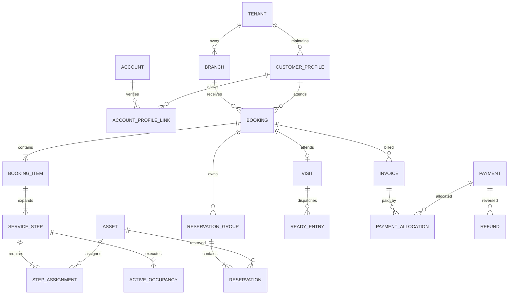
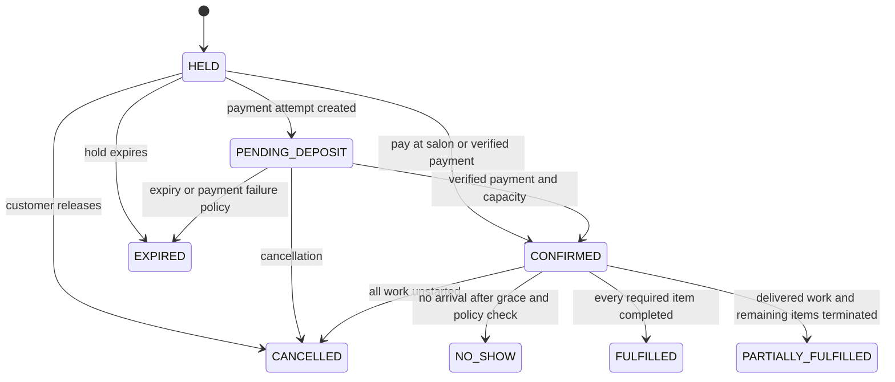

# Database, state and API contracts

This document is the implementation contract for the architecture. Table definitions are logical specifications; SQL excerpts illustrate critical guarantees and are not a complete executable migration. API listings define the required surface; generate and validate a complete OpenAPI 3.1 document during implementation.

## 1. Shared data conventions

- Use UUID primary keys. All tenant-owned tables have non-null `tenant_id`; branch-owned rows also have `branch_id`. Composite foreign keys enforce tenant equality and, where applicable, branch equality.
- Store timestamps as `timestamptz` in UTC. Store local recurring hours as weekday/time plus an IANA timezone and validity dates. Materialise shifts into absolute intervals. API timestamps use RFC 3339 with offset; `local_date` is a separate `YYYY-MM-DD` value.
- Use half-open intervals `[start, end)`: a chair released at 15:00 can be reserved at 15:00. Include actual setup, transition and cleanup in the correct resource intervals.
- Money is `bigint` minor units with a three-character currency, initially PKR. For example PKR 4,000 is 400,000 minor units. Use decimal arithmetic and explicit rounding for taxes/percentages. Send large integer amounts as decimal strings in JSON to avoid JavaScript precision loss; counts and duration minutes remain bounded numbers.
- Common mutable fields: `created_at`, `updated_at`, `version bigint`, `created_by`, `updated_by`. Domain revisions increment transactionally. Immutable facts have event timestamps, actor and originating command ID instead of editable history.
- State values use checked enums/text constraints. Validate lengths and ranges in both request schemas and the database. Archiving catalogues/memberships does not erase references. Never cascade-delete issued invoices, payments or audit history.
- Catalogue, policy, pricing, duration, tax and commission rules have immutable version rows. Confirmed booking/service lines reference and snapshot effective versions.
- All examples below use readable ID aliases; production payloads use UUIDs except opaque tokens, stream cursors and idempotency keys.

## 2. Relational model

### Identity, tenancy and customers

| Table | Key fields and relations | Constraints / behaviour |
|---|---|---|
| `accounts` | ID, verified contact identities, status, auth epoch | Platform identity only; contacts indexed for verified account lookup, never used as tenant-wide authorization. |
| `auth_identities` | Account, provider/type, normalised identifier, verification time | Unique active provider+identifier; controlled recovery for changed/recycled contacts. |
| `password_credentials` | Account, Argon2id hash, changed timestamp | Workforce only; no readable password. |
| `mfa_factors`, `recovery_codes` | Account, encrypted factor secret / hashed recovery code, enrollment state | Single-use recovery code; enrollment activated only after proof. |
| `sessions` | Hashed random token, account, auth epoch, idle/absolute expiry, MFA assurance | Revocation and logout authoritative in DB; cache cannot extend expired/revoked sessions. |
| `otp_challenges` | ID, purpose, destination digest, OTP keyed digest, attempt count, expires, consumed | Atomic attempt increment and consume; uniqueness/idempotency prevents duplicate verification. |
| `tenants` | Business identity, lifecycle, owner membership reference, billing plan | Last active owner cannot be removed; ownership transfer requires verified recipient and MFA. |
| `branches` | Tenant, name, address, timezone, currency, business-date rule, active | Unique tenant+branch ID; immutable historical timezone snapshots on bookings. |
| `memberships`, `membership_branches`, `role_permissions` | Account, tenant, roles, branch scopes, status | Tenant/account membership unique; capability checks incorporate monetary limits. |
| `support_grants` | Tenant, support account, reason, approver, scope, expiry | Time-limited and revocable; no implicit permanent superuser read access. |
| `customer_profiles` | Tenant, display name, contact fields, preferences, status, merged-into ID | A tenant may have guests without phone/account. No global shared salon notes. |
| `account_profile_links` | Account, tenant customer profile, relationship, verified scope | Self/organiser permissions explicit; unique relation; revoke without deleting history. |
| `customer_consents` | Profile, purpose, version, granted/revoked times, evidence | Separate service, image, marketing and external-processing purposes; history append-only. |
| `customer_notes`, `media_objects` | Tenant/profile/optional visit, sensitivity, authorised roles; private object key, checksum, scan/retention state | Restricted reads; consent and retention enforced; storage key is not a public URL. |
| `branch_policies`, `opening_hours`, `calendar_exceptions` | Branch, version/effective dates, cancellation/deposit/late rules; opening intervals and closures | Bookings snapshot policy; overnight intervals explicitly span dates. |

### Catalogue and capacity

| Table | Key fields and relations | Constraints / behaviour |
|---|---|---|
| `services`, `service_variants`, `service_versions` | Tenant, category, names/localisations; variant; immutable published version, price and qualification rule | Only published/branch-enabled variants bookable. Variable-price variants require an accepted quote. |
| `branch_services` | Branch, variant, effective price/version and publication status | Unique branch+variant+effective version. |
| `phase_templates` | Service version, sequence, type, duration, predecessor, min/max transition gap | Positive durations; acyclic ordered dependencies; setup/processing/cleanup explicit. |
| `phase_requirements` | Phase, skill or resource type, quantity, continuity requirement | Each required unit must map to a concrete asset when held. |
| `packages`, `package_items`, `add_on_rules` | Versioned items/quantities/discount allocation; allowed combinations | Expand to ordinary service items; cannot bypass variant constraints. |
| `professionals`, `professional_skills` | Tenant professional, optional workforce account; service skill, validity, duration override | Staff can work in multiple branches within tenant; active qualification required for every assignment. |
| `assets` | Tenant, kind `professional/resource/recipient`, optional owning branch, referenced entity, active | One logical asset per professional and recipient profile; one per chair/room/equipment unit. Professional asset is tenant-wide. |
| `resource_details` | Asset, branch, type, accessibility and privacy attributes, maintenance | Capacity N represented as N units initially; avoids unsafe aggregate-count booking. |
| `shift_templates`, `shift_instances`, `availability_exceptions` | Professional/asset, branch, intervals, breaks/leave, approval/version | Cross-branch shifts must include travel time and cannot conflict; changes use the booking lock protocol. |
| `travel_rules` | Tenant, branch pair, travel minutes | Default zero only for same branch; cross-branch travel requires configured duration. |
| `catalogue_stock_requirements` | Service version, product, quantity, mandatory flag | Essential product requirements are transactionally reserved. |

### Booking and service execution

| Table | Key fields and relations | Constraints / behaviour |
|---|---|---|
| `quotes` | Tenant/branch, recipient scope, catalogue/policy versions, plan fingerprint, line amounts, expiry | Immutable, server-computed; a quote is not capacity ownership. |
| `bookings` | Tenant/branch, customer recipient, organiser account, source, status, start/end, revision, quote snapshot, policy snapshot | Exactly one recipient/branch; public reference unique per tenant; booking and payment statuses independent. |
| `booking_items` | Booking, variant/package reference, sequence, price/duration/tax/discount snapshots, item status | Preserve canceled items and adjustments; amount allocations reconcile to quote. |
| `service_steps` | Item, phase template snapshot, predecessor, planned/actual times, state, forecast revision | No transition to ready until predecessor/processing gate permits; technical phase states drive execution. |
| `step_assignments` | Step, asset, role, allocation intervals | Staff must meet skill; physical resources in booking branch. |
| `reservation_groups` | Tenant, booking, plan revision, lifecycle | Own merged capacity intervals for one plan. Replacement holds reference original group. |
| `booking_holds` | Booking/group, actor, expires, state, replacement-of revision, quote | Expiry explicit; extension bounded; replacement stores delta plan and retains base. |
| `reservations` | Tenant, asset, group, `tstzrange`, kind, active, originating hold if provisional | Exclusion prevents any active overlap for same tenant+asset, including customer recipient. |
| `reschedule_proposals` | Booking, base revision, replacement hold, pricing delta, consent, state | Atomic swap only if base revision and replacement hold still valid. |
| `pass_tokens` | Booking revision, token hash, scope/branch, validity, revoked | At most one active pass generation; no raw personal data in QR. |
| `arrival_proofs` | Booking/visit, verification method, staff/device, timestamp, command | Immutable; duplicate command cannot create new arrival. |
| `visits` | Booking, branch business date, display sequence, state, arrived/completed/abandoned times | Unique booking→visit for a single attendance; a rebooked attendance uses a new booking. |
| `ready_entries` | Visit/step, eligibility time, due time, category, priority reason, call lease, version | At most one active entry per step; actual eligibility recalculated before call/start. |
| `active_occupancies` | Asset, step, started time, expected end, ended time | Unique open occupancy per asset; actual overruns don't rewrite historical bookings. |
| `delay_events`, `service_outcomes` | Step/visit, reason, forecast, professional, completion/termination notes | Append-only operational history with controlled sensitive fields. |
| `walk_in_waiting` | Profile/recipient, desired services, constraints, joined time, state | Has no promised capacity until converted to a held/confirmed plan. |
| `waitlist_requests`, `waitlist_offers` | Future constraints; linked hold, expires, contact preference, state | One active offer per request; only feasible offers; acceptance uses normal command. |

### Commerce, communications and operations

| Table | Key fields and relations | Constraints / behaviour |
|---|---|---|
| `invoices`, `invoice_lines`, `invoice_adjustments` | Tenant/branch, booking/visit, sequential document number, immutable totals, service/product snapshots | Issued numbers never reused; corrections use credit/debit adjustment documents. |
| `payment_attempts`, `payments`, `payment_allocations` | Provider or cash, amount/currency, idempotency ref, external ID, state; allocation to invoice/deposit | Provider transaction ID unique; allocation sums never exceed captured/unrefunded amount. |
| `refunds` | Payment, amount, reason, approver, provider request key, state | Lock parent payment; sum pending+succeeded refunds cannot exceed refundable balance. |
| `ledger_transactions`, `ledger_entries` | Source command, accounts such as cash/receivable/deposit liability/revenue/tax/tips; debit/credit amount | Append-only, balanced per currency/transaction, unique source; reversals create entries. Validate balance at commit. |
| `receipts` | Invoice/payment IDs, rendered payload snapshot, checksum, issue time, template version | Immutable; reprint metadata separate from receipt content. |
| `cash_sessions`, `cash_movements` | Branch/register, operator, opening/closing counts, discrepancy, approval | One open session per register; movements are immutable and deduplicated. |
| `commission_rules`, `commission_entries` | Rule version, professional, line allocation, earned/reversed amount, settlement ref | No double earning; refunds reverse original basis proportionally. |
| `products`, `stock_balances`, `stock_movements`, `stock_reservations` | Branch product/unit, on-hand/reserved; receipt/use/sale/adjustment; booking hold | Transactional quantity locks; nonnegative available essential stock; source-key deduplication. |
| `promotions`, `promotion_redemptions` | Versioned eligibility/caps; booking/account redemption | Atomic capacity and per-customer limits; rollback releases pending redemption. |
| `feedback` | Completed booking, rating, optional moderated text, consent/status | One submission per recipient visit; publication separate from internal feedback. |
| `notification_preferences`, `notifications`, `delivery_attempts` | Customer/actor, channel/purpose; template version, variables, state, provider ref | Unique event+recipient+purpose+channel; opt-out applies to marketing; no secrets in message body. |
| `scheduled_jobs` | Tenant, kind, run-after, aggregate revision, lease, retries, state | DB claim with skip-locked leases; stale reminders cancelled or ignored by revision check. |
| `outbox_events`, `consumer_inbox` | Event ID, tenant/branch, aggregate/version, minimal payload; consumer+event | Domain write and outbox atomic; dedupe retries in inbox. |
| `branch_streams`, `stream_events` | Branch counter; cursor sequence, audience, entity/version/event | Allocate sequence under branch row lock within transaction for commit order. |
| `idempotency_records` | Tenant, actor, operation, key, request hash, resource, result, expiry | Unique scope tuple; result stored with business commit; same key/different body rejected. |
| `audit_events` | Actor, tenant/branch, action, target, redacted before/after, reason, command, correlation ID | Append-only permissions; restricted export; sensitive reads included. |
| `ai_jobs`, `ai_drafts`, `ai_usage`, `metric_snapshots` | Scope/actor, redacted input TTL, prompt/model versions, validated draft, usage; deterministic metric values | AI inputs/outputs segregated from general logs; worker checks role again; costs attributed by tenant. |
| `webhook_inbox`, `reconciliation_runs` | Provider, merchant mapping, event ID/hash, verification, processing state; mismatch results | Deduplicate verified callbacks; never derive tenant from untrusted callback metadata alone. |
| `exports`, `deletion_requests`, `deletion_tombstones` | Scope/requester, job/object/expiry; deletion target and state | Export signed URL expires; deletions reapplied after restore. |

### Relationship overview



## 3. Critical database guarantees

PostgreSQL range exclusion can reject overlapping reservations at the database boundary. `btree_gist` supplies equality operator classes alongside time ranges. Verify the selected managed PostgreSQL version supports the required extension. [PostgreSQL range constraints](https://www.postgresql.org/docs/current/rangetypes.html)

```sql
-- Illustrative core; referenced entities, tenant policies and migrations omitted here.
CREATE EXTENSION IF NOT EXISTS btree_gist;

CREATE TABLE reservations (
    tenant_id uuid NOT NULL,
    id uuid NOT NULL,
    asset_id uuid NOT NULL,
    reservation_group_id uuid NOT NULL,
    period tstzrange NOT NULL,
    active boolean NOT NULL DEFAULT true,
    kind text NOT NULL CHECK (kind IN ('hold','confirmed','block')),
    PRIMARY KEY (tenant_id, id),
    FOREIGN KEY (tenant_id, asset_id) REFERENCES assets(tenant_id, id),
    FOREIGN KEY (tenant_id, reservation_group_id)
        REFERENCES reservation_groups(tenant_id, id),
    CHECK (NOT isempty(period)
        AND NOT lower_inf(period) AND NOT upper_inf(period)
        AND isfinite(lower(period)) AND isfinite(upper(period))
        AND lower_inc(period) AND NOT upper_inc(period)),
    EXCLUDE USING gist (
        tenant_id WITH =,
        asset_id WITH =,
        period WITH &&
    ) WHERE (active)
);

-- All old occupancies remain as history; only one can be open per asset.
CREATE UNIQUE INDEX one_active_occupancy_per_asset
ON active_occupancies (tenant_id, asset_id)
WHERE ended_at IS NULL;

CREATE UNIQUE INDEX one_command_result
ON idempotency_records (tenant_id, actor_id, operation, idempotency_key);

CREATE UNIQUE INDEX one_provider_payment
ON payments (provider, merchant_account_id, external_transaction_id)
WHERE external_transaction_id IS NOT NULL;
```

Never use `expires_at > now()` as the partial exclusion condition. Expired holds must be explicitly deactivated in a transaction. Merge a plan's touching/overlapping reservations per asset before insertion. Service-step allocations retain detail even when the capacity interval is merged.

Add unique keys for invoice sequence, branch/day display sequence, event/consumer pair, notification delivery key, stock movement source and payment/refund request keys. Financial amount checks forbid negatives where inappropriate and enforce same currency across allocations. Use deferred constraint triggers or a protected ledger-posting function to reject unbalanced ledger transactions at commit; ordinary application roles cannot edit posted entries.

Index `(tenant_id, branch_id, planned_start)`, `(tenant_id, customer_profile_id, planned_start DESC)`, `(tenant_id, professional_id, starts_at)`, ready entries by eligibility/due time, jobs by `(state, run_after)`, outbox by publication state, stream by `(tenant_id, branch_id, sequence)`, and provider reconciliation IDs. Partition high-volume audit/stream tables by time only after measuring volume; do not prematurely partition reservations in a way that breaks global exclusions.

RLS policies use `current_setting('app.tenant_id', true)` with a deny-by-default null case. `SET LOCAL` context is established by trusted backend code for each transaction; session pooling must not leak it. An RLS tenant filter does not substitute for branch capabilities or customer ownership checks. Apply both `USING` and `WITH CHECK` policies. Public projection views and privileged jobs need deliberately scoped DB roles and tests.

## 4. State machines and invariants

### Booking



`CONFIRMED` does not imply arrived or paid. Reschedule is an audited revision of a confirmed booking, not a separate lifecycle state. Cancelled/expired/no-show bookings never reopen silently; a staff reinstatement creates a new booking and references the old one. Payment received against an expired booking is reconciled, not treated as an automatic state transition without capacity.

Cancellation, expiry and no-show transitions release future capacity, stock/promotion holds and obsolete reminders in their transaction, and revoke any pass. No-show processing rechecks arrival evidence under the booking lock so it cannot race a check-in. It never terminates active service work.

### Visit and steps

Visit states: `ARRIVED → WAITING → IN_SERVICE → CHECKOUT → CLOSED`. A visit can return from `IN_SERVICE` to `WAITING` between service items. `ABANDONED` is allowed before completion, with partial work preserved. Closing requires a documented payment disposition (paid, approved receivable or waived), not necessarily a zero balance. Booking fulfillment is derived from item outcomes, not visit closure alone.

Step states: `PLANNED → READY → CALLED → ACTIVE → COMPLETED`; optional `ACTIVE → PROCESSING → READY` is represented by separate processing and follow-on phase steps rather than rewinding a completed step. `CALLED → TEMPORARILY_ABSENT → READY`; `PLANNED/READY/CALLED → CANCELLED`; `ACTIVE → TERMINATED` with reason. Processing steps activate by their configured transition and complete only at the server-authoritative deadline or explicit staff completion. Required occupied resources remain held throughout.

Keep operational state changes in one service orchestrator. Do not independently infer booking, visit and queue state in UI components. Invariant examples: a ready step must have an arrived visit; a completed step cannot be started; a cancelled booking has no live unstarted reservations or valid pass; a closed visit has no open occupancy; no two active steps can occupy the same asset; processing completion does not imply a professional is available for the next phase.

### Payment

Attempt: `CREATED → PENDING → SUCCEEDED | FAILED | EXPIRED | UNKNOWN`. A timeout can be `UNKNOWN`; a reconciliation job checks the provider. Money records distinguish authorised, captured, allocated, partially refunded and refunded amounts. Refund: `REQUESTED → APPROVED → SUBMITTED → SUCCEEDED | FAILED | UNKNOWN`. An unknown provider response keeps its original request key. Do not issue a fresh refund request merely because the HTTP response was lost.

### Notifications and AI

Notification: `QUEUED → SENDING → ACCEPTED → DELIVERED`, with `FAILED`, `UNKNOWN` and `SUPPRESSED`. Provider acceptance is not delivery. AI job: `QUEUED → RUNNING → READY | NEEDS_CLARIFICATION | FAILED | EXPIRED`; job completion cannot mutate a booking.

## 5. Transaction and concurrency algorithms

### Lock ordering

All scheduling-affecting mutations use the same order: branch rows by UUID → affected assets by UUID → bookings/groups by UUID → essential stock rows by UUID → stream-counter row if not already locked. Cross-branch staff operations lock every affected branch in sorted order. Never acquire a branch lock after already taking an asset lock. This intentionally serialises short capacity mutations within a branch; benchmark before replacing it with finer locks.

The affected lock set includes original and proposed reservations, retained resources, expired holds being released, and stock deltas. If revalidation discovers an additional branch or earlier-sorted asset, restart with the expanded set instead of acquiring it out of order. Capacity-changing schedule, expiry, cancellation and service-change jobs use this same protocol.

Use `READ COMMITTED` with this explicit lock protocol and exclusion constraints for capacity commands. Repeat the complete availability validation inside the transaction after locks. Use optimistic `version` checks for edit conflicts. Retry deadlocks/serialization failures at most twice with jitter only when the original idempotency identity is retained. Do not retry genuine capacity conflicts as if they were transient.

### Create hold

```text
validate session, capability, recipient relationship and command schema
begin transaction; set tenant context
claim idempotency scope and request hash
  if committed match exists: return authorised stored result
  if same key has different hash: reject
lock branches, candidate assets, booking/group and essential stock in order
expire relevant old holds; release their capacity/stock/promotion reservations
re-read quote/policy versions, branch hours, shifts, qualifications and actual occupancy
expand chosen plan; reject conflicts or infeasible dependencies
create HELD booking, items/steps, group, bounded hold and merged reservations
reserve mandatory stock and promotion redemption if applicable
write audit, stream event, outbox and command result
commit
return held booking and expires_at
```

Never leave an `IN_PROGRESS` idempotency row committed separately from a synchronous domain transaction. A competing request waits on the unique claim or gets `409 COMMAND_IN_PROGRESS` after a bounded lock timeout. Long external work uses a committed asynchronous job/result resource and returns `202`.

### Payment and booking confirmation saga

Persist a payment-attempt row and outbox job first; create the provider intent outside the transaction using the stable request key. Persist provider reference afterwards. If creation times out, query by that reference/key or leave unknown for reconciliation. The payment service may only use server-computed amount/currency/merchant mapping.

Webhook entry verifies signature over raw bytes, timestamp/replay rules and provider account, then stores a deduplicated inbox record before acknowledging. Worker locks payment plus booking and applies only valid amount/currency/status transitions. Confirmation rechecks hold validity and capacity using the scheduling lock protocol; update booking, payment allocation, deposit ledger, pass and outbox atomically. If locks from two modules are involved, precompute affected branches/assets before taking financial row locks to preserve ordering.

Provider-event ordering is not trusted. Query provider status when callbacks conflict. Each external transaction is booked into the ledger once. Run reconciliation for pending/unknown attempts every five minutes and daily against settlement data. Alert on captured money without allocation, duplicate provider IDs, failed refunds and unresolved balances.

### Reschedule

Create a replacement hold under locks. Compute each asset's new intervals minus that booking's existing confirmed intervals; reserve only extra intervals, plus new essential stock delta. At confirmation lock the same branches/assets, validate the base revision, remove old and delta reservations, insert merged complete new reservations, update steps and policy/price deltas, invalidate old pass, adjust reminder jobs and commit. If payment top-up fails or proposal expires, release delta only. All original appointment capacity remains until the swap commits. Reject reschedules after work starts; use an explicit service-change workflow instead.

### Start, complete and overrun

`start` locks the branch/assets/step, checks call lease and eligibility, verifies all assets have no open occupancy, creates occupancy rows and timestamps, and changes visit/step state in one transaction. `complete` closes occupancy (except explicitly continuing resource requirements), records product use idempotently, advances dependencies, recalculates ready steps and emits changes. Late completion preserves actual timestamps and marks downstream plans at risk. Only an explicit reallocation changes the reserved calendar.

### SSE and event reliability

Domain state, audit, minimal outbox event and durable stream event commit together. Allocate branch stream sequences using a locked counter row, not a freely allocated database sequence whose commit order can differ. A multi-event transaction uses consecutive sequence values; snapshot reads use repeatable-read and include the committed stream watermark.

Outbox relay leases unpublished rows and sends to the appropriate SQS queue. Publish acknowledgment is recorded after send; a crash can resend, so consumers deduplicate by event ID. Workers use `consumer_inbox` and business state checks. This delivers at-least-once execution with idempotent effects, not a promise of end-to-end exactly-once delivery. [AWS transactional outbox guidance](https://docs.aws.amazon.com/prescriptive-guidance/latest/cloud-design-patterns/transactional-outbox.html)

A live-update worker publishes a branch wakeup to Redis. Each API instance then reads durable ordered stream rows after its cursor; Redis is not the durable event store. Poll every five seconds as a safety net for lost wakeups. Clients use an opaque, audience-bound `Last-Event-ID`; reconnect replays permitted events within a 24-hour retention window. If too old, emit `snapshot_required`. Private, customer and display audiences get different projections; never broadcast one full payload to all recipients.

SSE sends a heartbeat every 20 seconds, rechecks session revocation at least every 30 seconds and closes on privilege loss. Limit connections per account/device and bound each client buffer; disconnect slow consumers for replay. Gateways disable caching/buffering for the stream. No auth tokens in query strings; use same-origin session cookies. All commands continue over HTTP.

## 6. API conventions

Base path `/api/v1`. JSON requests/responses; signed uploads use their separate restricted URL. Lists use opaque cursor pagination, maximum 100 rows. Default read scope is the authenticated tenant/branch/customer relationship, never a client-supplied all-tenants flag.

Successful commands return `data`, `meta.request_id`, `meta.server_time` and resource `version`. Creation returns `201`; long-running work `202` with status URL. Mutations require `Idempotency-Key`; edits/transitions also require `If-Match` with the current version. Browser clients send session cookie and CSRF token. Webhooks authenticate using provider verification instead of browser sessions.

Idempotency retention: keep retry records at least seven days for booking/arrival/service commands; financial command identities and provider references follow financial retention. After ordinary-key expiry, retain a compact tombstone and resource link for at least 90 days so an old key returns an expired/recovery response rather than replaying a mutation. Account switching cannot recover another actor's command. A key reused with a different payload returns `409 IDEMPOTENCY_KEY_REUSED`.

Errors use `application/problem+json` with `type`, `title`, `status`, stable `code`, user-safe `detail`, `request_id`, `retryable` and optional validated `field_errors`. Do not expose stack traces, private conflicting bookings or database constraint text.

| HTTP | Example codes | Client action |
|---|---|---|
| 400/422 | `INVALID_INPUT`, `UNSUPPORTED_SERVICE_COMBINATION`, `CONSENT_REQUIRED` | Correct form fields; preserve valid input. |
| 401 | `SESSION_EXPIRED`, `MFA_REQUIRED` | Recover session/assurance; do not blindly repeat writes. |
| 403 | `CAPABILITY_REQUIRED` | Explain missing access. |
| 404 | `RESOURCE_NOT_FOUND` | Also used for inaccessible cross-tenant objects to avoid existence leaks. |
| 409 | `SLOT_UNAVAILABLE`, `HOLD_EXPIRED`, `STEP_NOT_READY`, `PAYMENT_RECONCILIATION_PENDING`, `COMMAND_IN_PROGRESS` | Refresh options or recover pending command. |
| 412 | `VERSION_CONFLICT` | Fetch new state, show changed fields; require a new explicit decision. |
| 429 | `RATE_LIMITED`, `AI_BUDGET_EXCEEDED` | Respect `Retry-After`; offer non-AI workflow if relevant. |
| 503 | `STORAGE_UNAVAILABLE`, `PROVIDER_UNAVAILABLE` | Recover command status before retry; show degraded state. |

## 7. Required endpoint surface

All IDs in routes are scope-checked. “Staff” below means an explicit capability and assigned branch, not every workforce account.

### Identity and settings

| Method and path | Actor | Contract |
|---|---|---|
| `POST /auth/otp/challenges` | Public, limited | Phone + purpose → generic challenge acknowledgment; never log OTP. |
| `POST /auth/otp/verify` | Public challenge holder | Challenge + code → verified customer session; atomic consume. |
| `POST /auth/workforce/login` | Public, limited | Credentials → MFA challenge or authenticated session. |
| `POST /auth/mfa/verify` | MFA challenge holder | Proof → elevated session. |
| `POST /auth/mfa/enroll`, `/auth/mfa/activate` | Verified workforce | Start and verify enrollment; step-up for changes. |
| `POST /auth/recovery/start`, `/auth/recovery/complete` | Limited recovery flow | Generic initiation; verified reset revokes old sessions. |
| `GET /me`, `GET /me/sessions`, `DELETE /me/sessions/{id}` | Account | Identity/memberships and session revocation; deletion idempotent. |
| `POST /auth/logout` | Session | Revoke current session and cookie. |
| `GET/PATCH /tenants/{id}` | Owner | Tenant settings with version checks. |
| `POST/GET /branches`, `GET/PATCH /branches/{id}` | Owner/scoped staff | Branch creation/configuration and permitted read. |
| `POST /memberships/invitations`, `PATCH /memberships/{id}` | Owner | Verified onboarding, roles and scopes; no privilege self-escalation. |
| `POST /tenants/{id}/ownership-transfer` | Owner, step-up | Verified recipient, last-owner invariant and audit. |
| `GET/PUT /branches/{id}/policies` | Staff read; manager/owner write | Publish versioned policy with effective date. |

### Catalogue, discovery and availability

| Method and path | Actor | Contract |
|---|---|---|
| `GET /public/branches`, `/public/branches/{id}/services`, `/public/branches/{id}/professionals` | Public, limited | Published projections only. |
| `POST /services`, `POST /services/{id}/versions`, `POST /packages` | Catalogue manager | Draft/publish service phases, price and requirements. |
| `PATCH /branch-services/{id}` | Catalogue manager | Enable/archive or publish branch override; existing snapshots preserved. |
| `POST/GET/PATCH /professionals[/{id}]` | Staff read; manager write | Profile, qualification, branch assignment, duration overrides. |
| `POST/GET/PATCH /resources[/{id}]` | Staff read; manager write | Unit capacities, type, maintenance and privacy attributes. |
| `GET/PUT /professionals/{id}/availability` | Scoped professional read; manager write | Shifts/breaks/exceptions; change includes impact acknowledgment. |
| `POST /schedule-changes/preview`, `/schedule-changes/{id}/apply` | Manager | Enumerate impacted bookings and required resolution; atomic version check. |
| `POST /availability/search` | Customer or staff, limited | Branch, variants, date range, recipient/preferences → bounded feasible plans. |
| `POST /quotes` | Customer/staff | Selected plan/items → immutable server price/policy quote and expiry. |

The notation `POST/GET/PATCH /professionals[/{id}]` means POST collection, GET collection/detail and PATCH detail, not a literal bracketed URL. Apply the same convention to resources/products.

### Booking, arrival and service execution

| Method and path | Actor | Contract |
|---|---|---|
| `POST /booking-holds` | Customer/staff | Quote + recipient + plan fingerprint → HELD booking and expiry; no supplied price trusted. |
| `POST /booking-holds/{id}/confirm` | Owner of hold/scoped staff | Valid hold + approved tender policy → confirmed booking or pending deposit. |
| `DELETE /booking-holds/{id}` | Owner/scoped staff | Release provisional capacity idempotently. |
| `GET /bookings`, `GET /bookings/{id}` | Customer/scoped staff | Filtered snapshots; customer sees own/delegated recipients. |
| `POST /bookings/{id}/cancel` | Customer under policy/scoped staff | Reason + optional approved fee/refund disposition → cancel unstarted work. |
| `POST /bookings/{id}/reschedule-proposals` | Customer/scoped staff | New quote → replacement hold with old booking preserved. |
| `POST /reschedule-proposals/{id}/confirm` | Proposal actor/scoped staff | Consent + version + payment disposition → atomic swap. |
| `POST /bookings/{id}/service-change-proposals`, `/service-change-proposals/{id}/confirm` | Staff | Add/terminate items with price approval and fresh capacity; started work preserved. |
| `GET /bookings/{id}/pass`, `POST /bookings/{id}/pass/reissue` | Customer/scoped staff | Retrieve/reissue current pass with token rotation. |
| `POST /arrivals/scan`, `POST /arrivals/manual` | Reception | Versioned pass or verified booking reference → canonical visit; duplicate-safe. |
| `POST /walk-ins`, `GET /walk-in-waiting`, `POST /walk-in-waiting/{id}/convert` | Reception | Feasible booked admission or unreserved wait; conversion uses capacity transaction. |
| `POST/GET /waitlist-requests`, `POST /waitlist-offers/{id}/accept` | Customer/scoped staff | Future opening preferences; acceptance consumes real offer hold. |
| `GET /branches/{id}/operations`, `GET /me/work-plan` | Staff/professional | Versioned calendar/dispatch snapshots with authorised fields. |
| `POST /dispatch/call-next`, `POST /steps/{id}/call` | Reception/assigned professional | Branch/assets and version → single call lease. |
| `POST /steps/{id}/start`, `/complete`, `/delay`, `/mark-absent`, `/requeue`, `/terminate` | Assigned professional/scoped staff | Explicit commands with version, timestamps from server, reason where required. |
| `POST /steps/{id}/reassign` | Reception/manager | Qualified replacement, capacity check and audited reason. |
| `GET /visits/{id}/status`, `POST /visits/{id}/close` | Customer read; reception close | Minimal customer state; closing validates occupancy and financial disposition. |

### Commerce, customer data, reporting and integrations

| Method and path | Actor | Contract |
|---|---|---|
| `POST /payment-attempts` | Customer/scoped staff | Booking/invoice + tender → provider attempt; amount derived server-side. |
| `POST /invoices`, `GET /invoices/{id}`, `POST /invoices/{id}/issue` | Reception; customer own read | Draft line changes then immutable issue, including deposit application. |
| `POST /invoices/{id}/payments/cash`, `/payments/bank-verification` | Cashier | Amount + approved evidence/session → ledger and receipt; duplicate-safe. |
| `POST /payments/{id}/refunds`, `POST /refunds/{id}/approve` | Authorised staff/manager | Bounded amount, reason, approval and asynchronous provider result. |
| `GET /receipts/{id}`, `POST /receipts/{id}/reprints` | Customer/scoped staff | Immutable snapshot and audited print record. |
| `POST /cash-sessions`, `POST /cash-sessions/{id}/close` | Cashier/manager | Opening and counted closing amounts; discrepancies explicit. |
| `POST/GET/PATCH /products[/{id}]`, `POST /stock-adjustments`, `GET /stock` | Stock-capable staff | Units, stock count or reasoned adjustment; no raw balance overwrite. |
| `GET /commission-statements`, `GET /reports/{metric-set}` | Professional own / manager scoped | Versioned definitions, period, amounts and data freshness. |
| `POST/GET /customers`, `GET/PATCH /customers/{id}` | Reception or owning account | Tenant profiles with field-level visibility. |
| `POST /customers/{id}/consents`, `/notes`, `/merge` | Explicit capabilities | Versioned consent, restricted notes; merges manager-reviewed. |
| `POST /media/upload-intents`, `POST /media/{id}/complete`, `GET /media/{id}/download` | Scoped actor | Type/size/consent → quarantine upload; scan before authorised download. |
| `POST /bookings/{id}/feedback` | Verified recipient | Completed visit only; separate publication consent. |
| `GET /notifications`, `POST /notifications/{id}/read`, `PUT /me/notification-preferences` | Recipient | Cursor feed, idempotent read marker, channel/purpose choices. |
| `POST /exports`, `GET /exports/{id}`, `POST /privacy/deletion-requests` | Owner/subject within scope | Audited asynchronous export/deletion, signed expiring download. |
| `POST /ai/booking-drafts`, `GET /ai/booking-drafts/{id}` | Adult authorised workforce | Redacted intent → asynchronous validated draft or clarification. |
| `POST /ai/operations-briefs`, `GET /ai/operations-briefs/{id}` | Adult owner/manager | Metric snapshot → grounded narrative, no mutation capability. |
| `GET /events`, `GET /commands/{key}?operation={operation}` | Session and permitted audience | SSE replay / command recovery bound to current actor, tenant and explicit operation. |
| `POST /display-devices`, `DELETE /display-devices/{id}`, `GET /display/snapshot` | Manager provisioning; scoped device read | Device token only exposes anonymous branch display fields. |
| `POST /webhooks/payments/{provider}`, `/webhooks/messages/{provider}` | Verified provider | Signature/replay check, durable inbox, asynchronous processing. |
| `POST /platform/tenants`, `POST /platform/support-grants`, `GET /platform/health` | Platform capability | Controlled onboarding/support/operational state. |
| `GET /health/live`, `GET /health/ready` | Infrastructure | Minimal health signals; detailed dependency diagnostics restricted. |

## 8. Representative payloads

### Availability and hold

```json
{
  "branch_id": "branch-A",
  "recipient_profile_id": "customer-42",
  "items": [
    {"service_variant_id": "haircut-long", "professional_id": "stylist-7"},
    {"service_variant_id": "manicure-basic", "professional_id": null}
  ],
  "local_date_from": "2026-10-25",
  "local_date_to": "2026-10-25",
  "earliest_local_time": "17:00",
  "budget_minor": "400000",
  "currency": "PKR"
}
```

The response contains opaque `plan_id`, `plan_fingerprint`, `quote_id`, service-step timeline, assigned professional display fields, `starts_at`, `ends_at`, `total_minor`, `deposit_minor`, policy version and `valid_until`. It does not expose other customers' appointments.

```http
POST /api/v1/booking-holds
Idempotency-Key: 7b321a4c-b401-46d5-8b14-91dded23cbb1
X-CSRF-Token: <session-bound-token>
Content-Type: application/json

{
  "quote_id": "quote-81",
  "plan_fingerprint": "opaque-server-plan-hash",
  "recipient_profile_id": "customer-42",
  "accepted_policy_version": 3
}
```

```json
{
  "data": {
    "booking_id": "booking-91",
    "hold_id": "hold-17",
    "status": "HELD",
    "version": 1,
    "starts_at": "2026-10-25T17:00:00+05:00",
    "ends_at": "2026-10-25T18:15:00+05:00",
    "expires_at": "2026-10-24T13:05:00Z",
    "total_minor": "350000",
    "deposit_minor": "0",
    "currency": "PKR"
  },
  "meta": {"request_id": "req-51", "server_time": "2026-10-24T13:00:00Z"}
}
```

### Service transition and conflict

```http
POST /api/v1/steps/step-6/start
Idempotency-Key: b5b808e4-dc05-4373-986e-621d8a15476d
If-Match: "8"
X-CSRF-Token: <session-bound-token>
Content-Type: application/json

{"call_lease_id":"call-19","preparation_checklist_version":2}
```

```json
{
  "type": "urn:salon:problem:step-not-ready",
  "title": "The service cannot start yet",
  "status": 409,
  "code": "STEP_NOT_READY",
  "detail": "The assigned room is still occupied. Refresh the work plan.",
  "request_id": "req-52",
  "retryable": false
}
```

### Event envelope

```json
{
  "event_id": "event-55",
  "schema_version": 1,
  "type": "service_step.started",
  "tenant_id": "tenant-1",
  "branch_id": "branch-A",
  "aggregate_type": "service_step",
  "aggregate_id": "step-6",
  "aggregate_version": 9,
  "occurred_at": "2026-10-25T12:03:00Z",
  "correlation_id": "req-52",
  "payload": {"visit_id":"visit-20","forecast_revision":44}
}
```

This internal envelope is not automatically a public SSE payload. A customer projection might contain only their visit state, next service label, forecast range and version. A display projection contains only an anonymous call token and station label.

Domain events include `booking.held`, `booking.confirmed`, `booking.rescheduled`, `booking.cancelled`, `hold.expired`, `arrival.verified`, `visit.admitted`, `step.called`, `service_step.started`, `service_step.completed`, `delay.recorded`, `visit.closed`, `invoice.issued`, `payment.captured`, `refund.updated`, `schedule.changed`, `stock.low`, and `ai_job.completed`. Consumers declare schema versions and reject unknown required fields safely.

## 9. Time, notifications and files

Reminder jobs are persisted by booking revision. Defaults: confirmation immediately, reminders 24 hours and two hours before start, optional “ready soon” notification from deterministic forecasts, cancellation/reschedule updates and receipt after payment. If booking occurs inside a reminder window, skip obsolete reminders and avoid duplicates. Quiet hours apply to marketing; operational messages use explicit tenant/customer preferences. WhatsApp is enabled only with provider-approved templates and recorded channel permission; SMS/email remain adapters. AI-generated text is not sent automatically.

Job workers re-read booking state/revision before send. Use provider idempotency or status lookup where available; if provider acceptance is unknown, reconcile before a blind resend. Exactly-once SMS delivery cannot be guaranteed by local deduplication alone. Surface delivery failures to reception for important notices.

Upload flow: authorise consent/scope → reserve size/quota → issue short-lived signed upload URL to quarantine → verify actual size/type/checksum → malware scan and metadata removal → mark available → authorise short-lived download. Failed/uncommitted uploads are garbage-collected. Upload and download URLs are never logged; filenames are sanitised; secrets/customer names are not placed in object paths. Upload availability does not determine whether ordinary booking operations can proceed.
